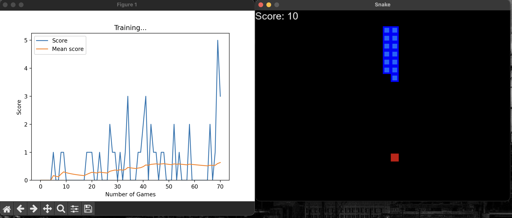

# Snake AI

A reinforcement-learning agent that teaches itself to play Snake using PyTorch and Pygame.



## Problem
Hand-coding a strategy for even a simple game gets messy fast, and it
never improves by itself. This project asks: can an agent learn to play
Snake purely from a reward signal, with no hand-written rules, and what
does it take to make that training stable?

## Based on
Built following the [freeCodeCamp tutorial](https://www.youtube.com/watch?v=L8ypSXwyBds). The Double DQN and
the other changes listed below are my own additions on top of it.

## Tech stack
Python 3.10, PyTorch, Pygame, Matplotlib, Conda (env: snake_ai)

## Key features
- Playable Snake game (human mode)
- Agent that trains itself using Deep Q-Learning
- Target network + Double DQN for steadier training
- Live plot of score and mean score during training
- Saved model you can load and watch play

## What I learned
- Chose Python 3.10 because PyTorch didn't work on older versions.
- How to build a game from scratch with Pygame.
- How to train an ML model and set up a reinforcement-learning agent.
- Why a target network and Double DQN stabilise training.

Full notes in [LEARNINGS.md](LEARNINGS.md)

## My changes
- **Target network and Double DQN:** one network chooses the next move,
  while a slowly updated network estimates its value. This makes the
  training targets steadier and reduces overestimation.
- **Gradient tracking disabled when choosing a move:** the agent only
  needs gradients during training, so turning them off when it is just
  picking an action avoids unnecessary computation.

## How to run
```bash
conda create -n snake_ai python=3.10
conda activate snake_ai
pip install -r requirements.txt
python agent.py
```

## Results (after 100 games)
Best score: 51, average score: 5.15

## Demo video
[link]
